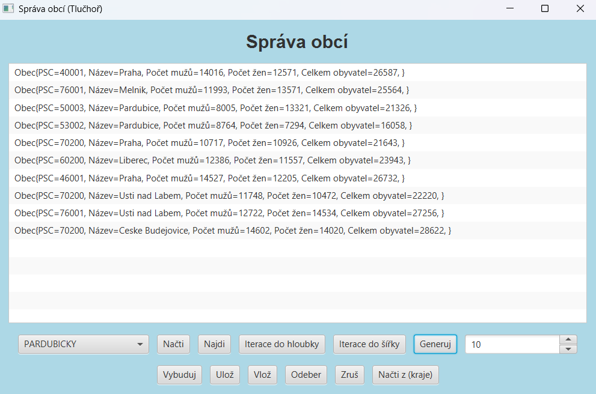

# Datové struktury – Semestrální práce B

**Akademický rok:** 2024/2025  
**Autor:** Aleš Tlučhoř  
**Předmět:** Datové struktury  
**Projekt:** Semestrální práce B

---

## O projektu

Tento projekt vznikl v rámci předmětu **Datové struktury** v akademickém roce 2024/2025 na Univerzitě Pardubice.

Cílem semestrální práce bylo rozšířit předchozí implementaci datových struktur a vytvořit aplikaci pro správu obcí jednotlivých krajů České republiky.

Hlavním úkolem bylo navrhnout a implementovat generickou vyhledávací strukturu založenou na binárním vyhledávacím stromu (BVS), doplnit ji o iterátory a vytvořit uživatelské rozhraní pro práci s daty.

## Ukázka aplikace

Hlavní okno aplikace pro správu obcí:



## Použité technologie

- **Java** – programovací jazyk
- **JavaFX** – grafické uživatelské rozhraní
- **Maven** – správa projektu a závislostí
- **NetBeans** – vývojové prostředí

## Implementované datové struktury

### Binární vyhledávací strom (BVS)

Generická vyhledávací struktura realizovaná pomocí dynamicky alokovaných uzlů.

Umožňuje:
- Vkládání prvků podle klíče.
- Vyhledávání prvků podle klíče.
- Odebírání prvků podle klíče.
- Zrušení celé tabulky.
- Kontrolu prázdnosti tabulky.

### Zásobník a fronta

- **ABSTRLIFO** – zásobník (Last In, First Out).
- **ABSTRFIFO** – fronta (First In, First Out).

Obě struktury jsou využívány také při procházení binárního vyhledávacího stromu.

### Iterátory

Implementace iterátorů umožňujících:
- Procházení stromu do hloubky.
- Procházení stromu do šířky.
- In-order průchod stromem.

## Aplikace AgendaKraj

Modul AgendaKraj zajišťuje správu obcí jednotlivých krajů České republiky.

Hlavní operace:
- Vyhledávání obcí.
- Vkládání nových obcí.
- Odebírání obcí.
- Budování vyváženého binárního vyhledávacího stromu.
- Vytváření iterátorů.
- Generování obcí.

## Uživatelské rozhraní

Pro ovládání aplikace slouží modul **ProgAgendaKraj** s grafickým formulářovým rozhraním.

Aplikace umožňuje:
- Zadávání vstupních dat z klávesnice.
- Načítání dat ze souboru.
- Generování vstupních dat.
- Zobrazení výsledků na obrazovce.
- Ukládání výstupů do souboru.

## Struktura projektu

```text
BDATS_SemB/
│
├── images/
│   └── hlavni-okno.png
│
├── src/
│   └── main/
│       └── java/
│
├── pom.xml
├── nbactions.xml
├── nb-configuration.xml
├── .gitignore
├── README.md
└── Zadani_Semestralni_Prace_B.pdf
```

## Zadání semestrální práce

Kompletní původní zadání projektu je dostupné v přiloženém PDF dokumentu.

📄 **[Zobrazit kompletní zadání semestrální práce B (PDF)](Zadani_Semestralni_Prace_B.pdf)**

## Autor

**Aleš Tlučhoř**

Univerzita Pardubice fakulta elektrotechniky a informatiky
Předmět: Datové struktury  
Akademický rok: 2024/2025

---

*Univerzitní projekt zaměřený na návrh, implementaci a praktické využití abstraktních datových struktur v jazyce Java.*